  

# Awesome Business Email Hosting 📬✨

  
  
  
  
  
  
  

> 🚀 **A curated, battle-tested list of Business Email Hosting SaaS providers, enterprise mail solutions, and self-hosted open-source mail servers.**  
> Everything you need for custom domains, mailbox migrations, SPF/DKIM/DMARC deliverability, secure groupware, and privacy-first communications.

---

## 📑 Table of Contents
- [🔍 SEO & Architecture Overview](#-sector-overview--market-dynamics)
- [☁️ SaaS / Hosted Business Email Platforms](#️-saashosted-platforms)
- [🐧 Open-Source GitHub Projects & Self-Hosted Mail Stacks](#-open-source-github-projects)
- [🤝 How to Contribute](#-how-to-contribute)
- [💖 Support & Sponsorship](#-support--sponsorship)
- [📈 Star History](#-star-history)
- [⚠️ Disclaimer](#️-disclaimer)

---

## 🌐 Sector Overview & Market Dynamics

The global business email hosting and enterprise cloud collaboration market is valued between **$21 billion and $37 billion**, projected to expand steadily at a ~9% to 15% CAGR driven by cloud infrastructure migration, strict privacy compliance mandates (GDPR, HIPAA, SOC 2), and AI productivity workflows. 

The sector exhibits a **barbell market concentration dynamic**:
* 🏢 **Enterprise Tier (Highly Concentrated / Oligopoly)**: Dominated heavily by Microsoft 365 / Exchange Online and Google Workspace, capturing the lion's share of enterprise-scale groupware deployments.
* 🛡️ **SMB & Privacy Tier (Moderately Fragmented Long-Tail)**: A vibrant, highly competitive ecosystem where independent SaaS hosts (Zoho, Fastmail, Proton Mail, Mailbox.org, IceWarp) and self-hosted open-source mail stacks (docker-mailserver, Stalwart, mailcow, Mail-in-a-Box) serve organizations demanding cost efficiency, sovereign hosting, zero-access encryption, and anti-lock-in freedom.

---

## ☁️ SaaS/Hosted Platforms

A comprehensive comparison of top commercial business email hosting solutions, featuring exact starting tier pricing, free trial specifications, and company valuation data:

| Company / Product | Company Size (Revenue / Valuation) | Starting Tier Pricing | Free Tier / Trial Limits | Description & Key Capabilities |
| :--- | :--- | :--- | :--- | :--- |
| **[Microsoft Exchange Online (Microsoft 365)](https://www.microsoft.com/en-us/microsoft-365/)** 🏢 | ~$3.1T Market Cap / ~$245B ARR | $6.00 / user / month (Exchange Online Plan 1 or M365 Business Basic annual commitment) | 30-day free trial; capped at 25–300 users, 50 GB mailboxes, web/mobile Office apps | Enterprise-grade email hosting with 50 GB mailboxes, 1 TB OneDrive storage, free shared mailboxes, and deep integration with Microsoft Teams and Office apps. |
| **[Google Workspace](https://workspace.google.com/)** 🔍 | ~$2.2T Market Cap (Alphabet) / ~$40B ARR (Google Cloud) | $6.00 – $7.00 / user / month (Business Starter annual commitment) | 14-day free trial; max 10 users, external sending capped at 500 emails/day | Gmail-based business email with 30 GB pooled storage across mail and Drive, Google Meet, Docs, and deep integration with the Google ecosystem. |
| **[Zoho Mail](https://www.zoho.com/mail/)** 💼 | ~$1.5B ARR / ~$12B Valuation (est.) | $1.00 / user / month (Mail Lite, 5 GB/user annual commitment) | Free forever plan: Up to 5 users, 5 GB/user storage, 1 custom domain (webmail and mobile app access only, no IMAP/POP/ActiveSync) | Low-cost business email with custom domains, aliases, shared calendars, and SPF/DKIM/DMARC configuration. Deeply integrated with Zoho CRM and Docs. |
| **[Rackspace Email](https://www.rackspace.com/email-hosting)** ☁️ | ~$640M Market Cap / ~$2.7B Revenue | $2.99 – $3.99 / mailbox / month (Basic hosted email) | 14-day free trial; full mailbox features (25 GB mailbox storage, 30 GB file storage) | Managed business email with 99.9% uptime SLA, 24/7/365 human support, ad-free webmail, and robust anti-spam/anti-virus protection. |
| **[Intermedia Hosted Exchange](https://www.intermedia.net/)** 🔄 | ~$1.8B Valuation / ~$450M ARR | $7.49 / user / month (Exchange Email standalone) | No self-service free trial; available via customized sales demo / proof-of-concept (POC) | Managed Exchange hosting with controlled cutover planning for mailbox migrations, organization-level retention policies, and audit-ready governance. |
| **[Titan Mail](https://titan.email/)** ⚡ | ~$300M Valuation / ~$19M ARR | $1.50 – $2.00 / user / month (Business Email starting tier) | 30 to 90-day free trial (available via domain registrars like WordPress.com & Name.com); standard direct trial is 30 days | Business email with custom domains, webmail, mobile apps, and lightweight productivity tools designed for entrepreneurs and small businesses. |
| **[Proton Mail Business](https://proton.me/business)** 🔒 | ~$100M ARR / Non-profit Trust controlled | $7.99 / user / month (Mail Essentials annual commitment) | Free personal plan (1 GB storage, 1 email address, 150 emails/day, no custom domains); 30-day money-back guarantee for business plans | Privacy-focused business email with zero-access encryption by default, Swiss jurisdiction, custom domains, and bundled encrypted Calendar, Drive, and VPN. |
| **[Fastmail](https://www.fastmail.com/)** 🚀 | ~$35M – $50M ARR (est.) / Privately held | $3.00 / user / month (Individual/Basic) or $5.00 / user / month (Standard with custom domains) | 30-day free trial; restricted to 120 outgoing emails/day, full webmail access | Standards-based email with fast search, full IMAP/SMTP/JMAP support, masked email integration, and a polished calendar/contacts interface. |
| **[IceWarp](https://www.icewarp.com/)** ❄️ | ~$25M – $40M ARR (est.) / Privately held | $2.50 – $3.50 / user / month (Cloud Business tier) | 30-day free trial; full collaboration suite access (mailboxes, TeamChat, documents, web meetings) without credit card | Complete all-in-one email and collaboration suite (mail, chat, meetings, documents) available as cloud or on-premises deployment, serving 50k+ companies. |
| **[Mailbox.org](https://mailbox.org/)** 🛡️ | ~$10M – $20M ARR (est.) / Privately held | €1.00 – €3.00 / user / month (~$1.10 – $3.30, Light to Standard tier) | 30-day free trial; limited to 100 MB mail storage, 10 MB cloud storage, and 10 outbound emails/day to prevent abuse | German privacy-focused email provider offering PGP encryption support, GDPR compliance, EU hosting, and integrated office tools based on OX App Suite. |

---

## 🐧 Open-Source GitHub Projects

Curated open-source mail servers, webmail interfaces, groupware platforms, and self-hosted mail stacks, ranked by GitHub_Stars:

- **[docker-mailserver](https://github.com/docker-mailserver/docker-mailserver)**  🐳  
  A production-ready, full-stack, containerized mail server (Postfix, Dovecot, Rspamd, ClamAV, OpenDKIM) configured strictly via configuration files and environment variables, with no SQL database required.
- **[Stalwart Mail Server](https://github.com/stalwartlabs/mail-server)**  🦀  
  Modern, secure all-in-one mail server written in Rust. Implements JMAP, IMAP4, SMTP, DMARC, DKIM, SPF, and integrated spam filtering with high throughput and low memory footprint.
- **[Mail-in-a-Box](https://github.com/mail-in-a-box/mailinabox)**  📦  
  Turnkey one-command mail server deployer for Ubuntu servers. Automates DNS (with DNSSEC), SSL certificates, Postfix, Dovecot, Roundcube webmail, Nextcloud contacts/calendars, and spam filtering.
- **[mailcow: dockerized](https://github.com/mailcow/mailcow-dockerized)**  🐮  
  Docker-native groupware and email suite bundling Postfix, Dovecot, Rspamd, ClamAV, and SOGo into a unified web administration UI with REST APIs and ActiveSync support.
- **[Mailu](https://github.com/Mailu/Mailu)**  ⛵  
  Modular, container-first mail server distribution aiming to stay easily configurable, secure, and resilient with a sleek web administration panel and optional webmail.
- **[Roundcube Webmail](https://github.com/roundcube/roundcubemail)**  🌐  
  Browser-based multilingual IMAP client with an application-like user interface, full MIME support, address book, folder manipulation, message searching, and spell check.
- **[SimpleLogin](https://github.com/simple-login/app)**  🛡️  
  Open-source email alias and forwarding solution to protect email privacy and prevent marketing trackers, fully integrable with business custom domains.
- **[mox](https://github.com/mjl-/mox)**  ⚡  
  Modern, single-binary all-in-one mail server written in Go (SMTP, IMAP, HTTPS, SPF, DKIM, DMARC) with automated Let's Encrypt TLS and automatic DNS configuration generation.
- **[Haraka](https://github.com/haraka/Haraka)**  🚀  
  High-performance, event-driven SMTP mail server written in Node.js, featuring a rich plugin architecture for routing, filtering, and delivery.
- **[AddyManager / AnonAddy](https://github.com/anonaddy/anonaddy)**  🎭  
  Open-source anonymous email forwarding and alias management system supporting custom domain routing and PGP encryption for forwarded messages.
- **[Modoboa](https://github.com/modoboa/modoboa)**  🐍  
  Python and Django-based mail hosting management platform and webmail interface with Postfix/Dovecot/Rspamd integration, calendar, contacts, and DMARC reporting.
- **[SOGo](https://github.com/Alinto/sogo)**  👥  
  Open-source groupware server with a rich webmail interface, CalDAV/CardDAV support, and native Microsoft ActiveSync synchronization for smartphones and Outlook.
- **[iRedMail](https://github.com/iredmail/iRedMail)**  📮  
  Battle-tested mail server installation script for Linux and BSD distributions supporting OpenLDAP, MySQL, MariaDB, and PostgreSQL backends.
- **[Cypht](https://github.com/cypht-org/cypht)**  📬  
  Lightweight open-source webmail and news aggregator client written in PHP and JavaScript, supporting IMAP, JMAP, SMTP, and RSS feeds.
- **[SnappyMail](https://github.com/the-djmaze/snappymail)**  💌  
  Fast, modern, and lightweight open-source webmail client evolved from RainLoop, featuring low memory usage, 2FA, and PGP/GPG encryption support.
- **[Nextcloud Mail](https://github.com/nextcloud/mail)**  ☁️  
  The official open-source webmail app for the Nextcloud productivity platform, integrating seamlessly with Nextcloud Contacts, Calendar, and Deck.
- **[chasquid](https://github.com/albertito/chasquid)**  📨  
  Zero-dependency, memory-safe SMTP server written in Go with automatic Let's Encrypt certificates and integrated SPF/DKIM validation.
- **[docker-mailserver (jeboehm)](https://github.com/jeboehm/docker-mailserver)**  🐋  
  Containerized mail server setup with Rspamd, ClamAV, Dovecot, Postfix, and a built-in web management interface.
- **[grommunio Web](https://github.com/grommunio/grommunio-web)**  🖥️  
  Open-source NextGen groupware web application providing email, calendar, contacts, tasks, and notes with Microsoft Exchange protocol compatibility.

---

## 🤝 How to Contribute

Contributions are warmly welcome! Help keep this ecosystem guide accurate and up-to-date:

1. 🍴 **Fork the repository**
2. 🌿 **Create a feature branch**: `git checkout -b feature/new-email-service`
3. 📝 **Add or edit entries**: Ensure strict pricing, trial limits, and official links are provided.
4. 🚀 **Commit your changes**: `git commit -m "Add new business email solution"`
5. 📤 **Submit a Pull Request** with a brief summary of additions or updates.

---

## 💖 Support & Sponsorship

Thank you so much for exploring and supporting **Awesome Business Email Hosting**! 🌟

If this repository helped you find the perfect email host or self-hosted mail architecture for your business, please consider:
- ⭐ **Starring** the repository on GitHub
- 🍴 **Forking** and contributing new tools
- 📢 **Sharing** with your colleagues, DevOps engineers, and sysadmin network
- ☕ **Buying a coffee & sponsoring the project**:  
  

Your support keeps this curated ecosystem maintained, accurate, and community-driven! 🙌

---

## 📈 Star History

---

## ⚠️ Disclaimer

- This is an independent **community-curated** list — not exhaustive and not a paid endorsement.
- Business email hosting must adhere to applicable regulatory data protection requirements (GDPR, HIPAA, CCPA, SOC 2) and record retention guidelines.
- Self-hosted mail servers require proper DNS hygiene (SPF, DKIM, DMARC, reverse DNS PTR), IP reputation monitoring, and open port 25 access; misconfigurations can lead to deliverability failure.

---

  <b>Built for IT Administrators, Founders, Privacy Advocates &amp; Infrastructure Engineers.</b> 
  Let's make business email hosting open, controllable, and dependable.

